<div align="center">

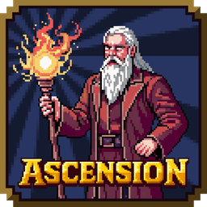

<br />


# Sâm Lốc: Ascension

**The Northern-Vietnamese card game Sâm Lốc, re-forged in high-fantasy pixel art.**

*Báo sâm, then run the whole table without a single card stopping you.*

<br />


<br />

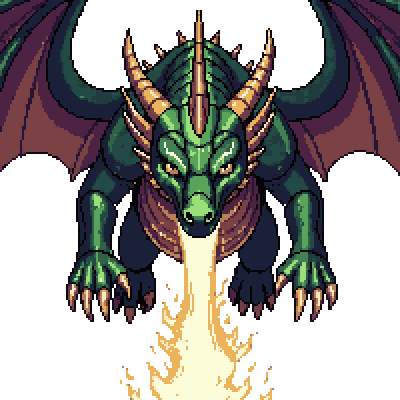
&nbsp;&nbsp;
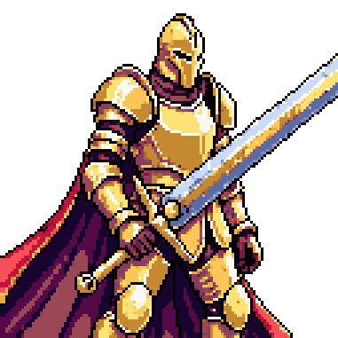

<sub><b>SẢNH RỒNG</b> &nbsp;·&nbsp; <b>TỨ QUÝ 2</b>: cinematic splashes for the rarest hands</sub>

</div>

---

## ⚔️ The game

**Sâm Lốc** is the shedding game of Northern Vietnam: be the first to empty your
10-card hand, and make everyone else pay for every card they're still holding.

**Ascension** keeps the rules and the Vietnamese vocabulary front and centre (*đánh*,
*chặt*, *đền*, *thối*, *ăn trắng*, *báo sâm*) and wraps them in a warm, crimson-and-gold
fantasy tavern where a jester, an assassin, a wizard, a knight and a dragon are waiting for a
legendary hand. The title comes from
**báo sâm**: declaring, before the first card falls, that your hand can't be beaten.

<div align="center">
  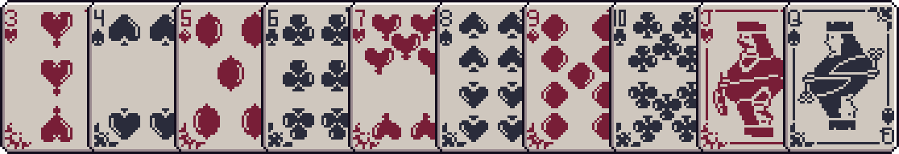
  <br />
  <sub>A ten-card straight. Deal it and you win on the spot: <b>ăn trắng</b>.</sub>
</div>

## 📸 In game

<div align="center">

<table>
  <tr>
    <td align="center">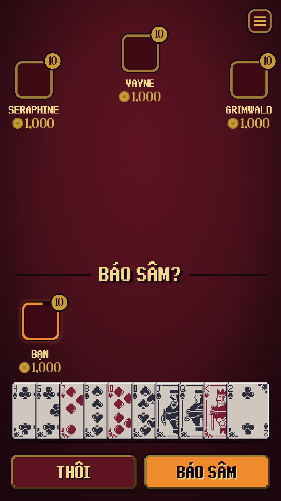<br /><sub><b>BÁO SÂM?</b><br />the claim window</sub></td>
    <td align="center">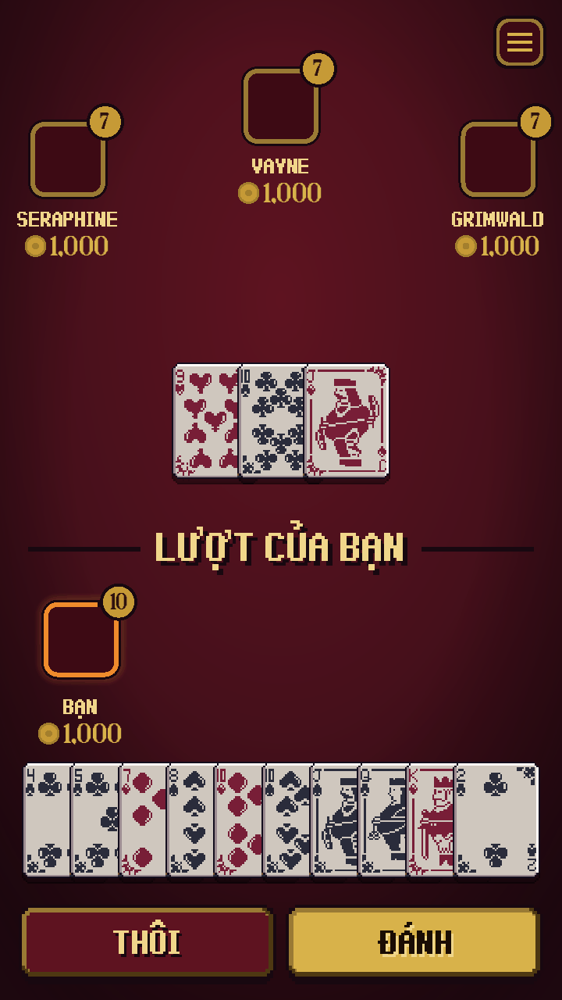<br /><sub><b>LƯỢT CỦA BẠN</b><br />your turn</sub></td>
    <td align="center">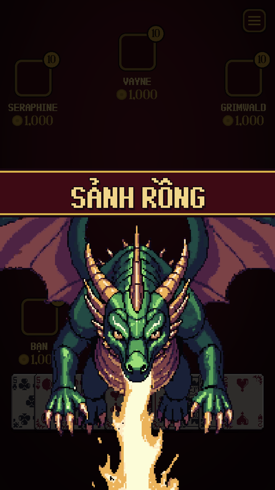<br /><sub><b>SẢNH RỒNG</b><br />a ten-card straight</sub></td>
    <td align="center">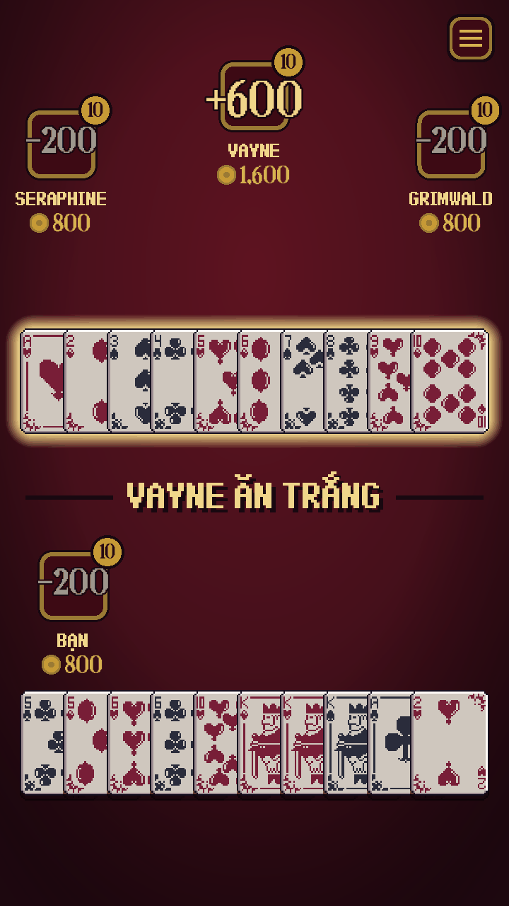<br /><sub><b>ĂN TRẮNG</b><br />instant win, +600</sub></td>
    <td align="center">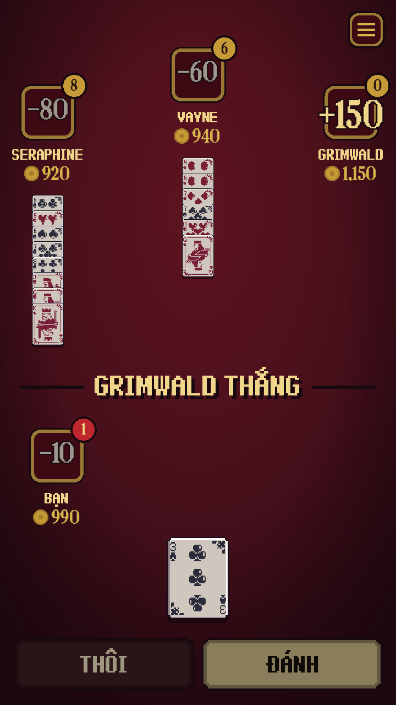<br /><sub><b>GRIMWALD THẮNG</b><br />payouts and reveal</sub></td>
  </tr>
</table>

<sub>Captured from the Godot 4.6 build at 720 × 1280. Hero portraits aren't in yet, so the seat frames are empty.</sub>

</div>

## ✨ Features

- 🃏 **Full Sâm Lốc rules engine**: singles, pairs, triples, quads, straights, chops and every
  special-case payment, written as pure GDScript.
- 🤖 **Play offline against bots**: Grimwald, Vayne and Seraphine fill the table. No network needed.
- 💰 **Persistent coin session**: everyone starts at **1000**, money is zero-sum across deals,
  broke bots bust out, and the table shrinks from 4 → 3 → 2 players.
- 🐉 **Dark-fantasy combo cinematics**: dimmed screen, earthquake, and a full-width character
  rising under a gold-framed banner. Every ăn trắng hand, every quad, and every broken báo sâm
  has its own.
- 📱 **Built for phones**: portrait-locked, notch-aware layout that stretches cleanly from thin
  phones to squarer tablets.
- 🇻🇳 **Vietnamese UI**: `ĐÁNH`, `BỎ LƯỢT`, `LƯỢT CỦA BẠN`, `… THẮNG`, with full diacritics
  in the DearPix pixel font.

## 📜 How to play

<details open>
<summary><b>The basics</b></summary>
<br />

| | |
|---|---|
| **Players** | 2–4, each dealt 10 cards |
| **Rank order** | `3` `4` `5` `6` `7` `8` `9` `10` `J` `Q` `K` `A` `2`, deuces are highest. Suits don't matter. |
| **Combos** | single · pair · triple · quad · straight (3+ in a row, `A-2-3…` up to `…Q-K-A`, no wrapping) |
| **Beating a play** | Same type, same size, higher rank |
| **Passing** | Pass (or run out the clock) and you're out of the trick until someone leads a new one |
| **Winning** | Empty your hand first. The winner leads the next deal. |

</details>

<details>
<summary><b>💥 Chặt: chopping the deuces</b></summary>
<br />

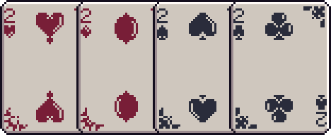

Deuces are the top cards, but a **quad (tứ quý)** cuts them down:

- a **quad** beats a single `2`
- a **double quad** (two quads) beats a pair of `2`s
- a **higher quad** beats a lower quad

The chopped player pays the chopper **15 stakes per 2/quad**, right away. Chop a chop and it
pays ×2, chop that and it pays ×3, and so on.

<br clear="right" />
</details>

<details>
<summary><b>🏆 Scoring</b></summary>
<br />

The **stake** is 10 coins. The winner sweeps the whole pot.

| Situation | Each loser pays |
|---|---|
| Normal loss | **1 stake per card** left in hand |
| Leftover `2` or quad | **+5 stakes** each |
| **Móm** (never played a card) | **15 stakes** for the cards instead of 10 |

</details>

<details>
<summary><b>☠️ Thối 2: finishing on a deuce</b></summary>
<br />

You *can* empty your hand on a play that includes a `2`, but it's a foul. You win nothing,
and you pay **15 stakes to every other player**. Get rid of your deuces before the final play.

</details>

<details>
<summary><b>🛡️ Đền: the block obligation</b></summary>
<br />

When an opponent has **one card left**, you have to block them properly. If you play a single
that **isn't your highest** and that player beats it to go out **on the spot**, you **đền**:
you pay your own losing amount to each of the other losers.

Playing your highest single, or leading a combo, is always safe.

</details>

<details>
<summary><b>👑 Ăn trắng: instant wins on the deal</b></summary>
<br />

Some hands win the moment they're dealt. Strongest to weakest:

1. **3 triplets**
2. **10-card straight** (*sảnh rồng*) 🐉
3. **5 pairs**
4. **10-card single-colour flush** (all red or all black)
5. **Quad of deuces** (*tứ quý 2*) ⚔️

Each loser pays a flat **20 stakes**.

Every ăn trắng hand gets its own dark-fantasy splash before the cards fly:

<table align="center">
  <tr>
    <td align="center">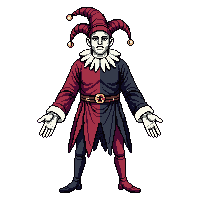<br /><b>3 SÁM CÔ</b><br /><sub>3 triplets</sub></td>
    <td align="center"><br /><b>SẢNH RỒNG</b><br /><sub>10-card straight</sub></td>
    <td align="center">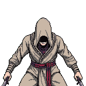<br /><b>5 ĐÔI</b><br /><sub>5 pairs</sub></td>
  </tr>
  <tr>
    <td align="center">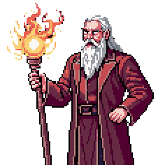<br /><b>ĐỒNG HOA ĐỎ</b><br /><sub>all-red flush</sub></td>
    <td align="center">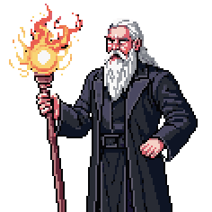<br /><b>ĐỒNG HOA ĐEN</b><br /><sub>all-black flush</sub></td>
    <td align="center"><br /><b>TỨ QUÝ 2</b><br /><sub>quad of deuces</sub></td>
  </tr>
</table>

</details>

<details>
<summary><b>🔮 Báo sâm: the namesake</b></summary>
<br />

Before each deal there's a short claim window. Declare **báo sâm** to take the lead, then you must
win **every** trick without being blocked.

- **Succeed:** +20 stakes from each opponent
- **Fail** (your lead gets beaten, or you give it up): pay 20 stakes to each opponent

Fouling on a deuce during báo sâm also counts as a failed declaration.

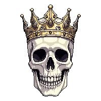

When an opponent's play breaks your báo sâm, the crowned skull of **CHẶT SÂM** rises before
their cards hit the table.

<br clear="right" />

</details>

## 🛠️ Getting started

**You'll need:** [Godot 4.6](https://godotengine.org/download) (standard build, no plugins).

```bash
git clone https://github.com/hail75/sam-loc-ascension.git
cd sam-loc-ascension
godot --editor project.godot    # or open it from the Godot Project Manager
```

Press **F5** to play. The main scene is `scenes/table/table_a.tscn`.

> [!TIP]
> To test on the web, use **Project → Export → Web**. The project uses the **Compatibility**
> renderer (OpenGL ES 3 / WebGL2), so the same build runs in a browser and on older phones.

> [!NOTE]
> Set `GameState.AN_TRANG_DEBUG = true` (in `autoload/game_state.gd`) to deal Vayne
> `AN_TRANG_DEBUG_HAND` every hand (an A–10 straight by default, so SẢNH RỒNG), which makes the
> ăn trắng cinematic easy to test. Swap that hand to try other tiers. Keep the flag `false` for real play.

## 🏰 Architecture

Ascension is **offline-first**, but it's built so the game logic can later move to an
authoritative server (Python / FastAPI over WebSockets) without changing the UI.

```
              ┌──────────────────────────┐
  tap / bot ─▶│  scenes/table/table_a.gd │  rendering, input, animation only
              └────────────┬─────────────┘
                           │ actions          ▲ signals
                           ▼                  │ dealt · played · passed ·
              ┌──────────────────────────┐    │ chopped · rejected · match_ended
              │  autoload/game_state.gd  │────┘
              │  the single runtime path │  ← later: send over WebSocket
              └────────────┬─────────────┘
                           │ (state, action)
                           ▼
              ┌──────────────────────────┐
              │  rules/sam_loc_rules.gd  │  pure, Node-free, portable
              │  → { ok, state, reason } │
              └──────────────────────────┘
```

| Path | What it does |
|---|---|
| `rules/sam_loc_rules.gd` | **The engine.** Static `SamLocRules`: `deal` · `classify` · `is_valid` · `beats` · `apply` · `settle`. Also contains the offline reference bot (`find_play`). |
| `rules/game_state_data.gd` | `GameStateData`: plain, serialisable match state plus `clone()`. Data only. |
| `rules/deck.gd` | `Deck`: a pure shuffled-deck helper. |
| `autoload/game_state.gd` | `GameState`: holds the live state and balances, sends every action through the engine, emits signals. **No game logic.** |
| `scenes/table/` | The playable table: seats, dealing, tricks, payouts, combo splashes. |
| `scenes/card`, `scenes/seat`, `scenes/ui` | Reusable card, seat and pixel-button scenes. |
| `scripts/palette.gd`, `scripts/pixel_draw.gd` | Design-system colours and pixel-drawing helpers. |
| `assets/` | Card sheet, deck stacks, DearPix font, and the splash sprite sheets in `assets/splash/` (16-frame horizontal strips). |

## 🎨 Design system

Warm, rich, polished pixel art. Portrait **720 × 1280**, `canvas_items` stretch, `expand` aspect.
Textures use **Nearest** filtering with mipmaps off.

| | Token | Hex |
|---|---|---|
|  | felt | `#7a1226` |
|  | table | `#6a0f20` |
|  | frame | `#3d0a14` |
|  | outline | `#180810` |
|  | ember | `#ef8b2c` |
|  | gold | `#d8b24a` |
|  | gold-dk | `#b8902f` |
|  | gold-hi | `#f0d68a` |
|  | card-face | `#cfc7be` |
|  | pip-red | `#781e37` |

Fonts: **DearPix** for display text, numbers and labels.

## 🗺️ Roadmap

- [x] Full rules engine: combos, chops, đền, thối 2, ăn trắng, báo sâm
- [x] Offline play against bots, with a persistent coin session and elimination
- [x] Combo cinematics for every ăn trắng hand, every quad, and a broken báo sâm (*chặt sâm*)
- [ ] Bots that can báo sâm
- [ ] Authoritative Python / FastAPI WebSocket server
- [ ] Online multiplayer
- [ ] Store releases on iOS and Android

---

<div align="center">

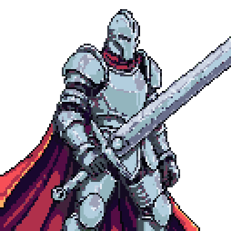

**Báo sâm. Hold the table. Ascend.**

<sub>Made with Godot · Rules from Northern Vietnam · Art from a high-fantasy world</sub>

</div>
